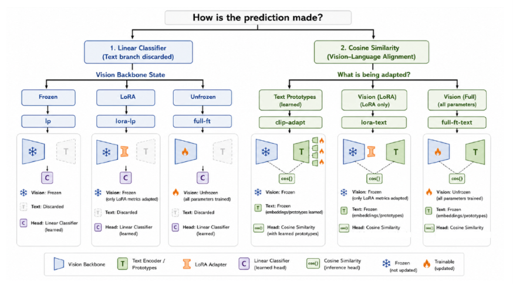

# The Impact of Adaptation on Fairness in Medical Multimodal Foundation Models

[Alaa Yasser](https://openreview.net/profile?id=~Alaa_Yasser1), [Catarina Barata](https://openreview.net/profile?id=~Catarina_Barata1), [Luis Herranz](https://openreview.net/profile?id=~Luis_Herranz2), [Marcos Escudero-Viñolo](https://openreview.net/profile?id=~Marcos_Escudero-Vi%C3%B1olo1)

Official PyTorch implementation and reproduction benchmark for the paper:  
**"The Impact of Adaptation on Fairness in Medical Multimodal Foundation Models"**

---

## Abstract

Fairness benchmarks for medical vision-language models are recent, and the conventions they use to measure demographic disparity are still forming. We ask whether four of those conventions are consequential, that is, whether a reader would reach a different conclusion had they been made otherwise. Treating the adaptation strategy as the variable of interest, we evaluate seven strategies on ophthalmology (FairVLMed10k) and radiology (CheXpert) with a general-domain and a medical-specific backbone, and four of them on dermatology (DDI). We find that binarising demographic attributes can only make a model look fairer, so a benchmark that binarises reports a bound on disparity rather than an estimate. Fairness varies across the epochs from which a checkpoint could plausibly be drawn, and that variation is three to five times larger for methods that update the visual encoder than for those that keep it frozen. Intersectional gaps run several times larger than the marginal gaps they are built from, and adaptation narrows some while widening others. Under-representation and disease prevalence have separable effects, and which adaptation strategy benefits from correcting them depends on the mechanism rather than on the number of updated parameters. 

---

## Adaptation Taxonomy

Downstream adaptation of multimodal foundation models is structured across two axes: **how predictions are formed** (unimodal classifier head vs. vision-language cosine alignment) and **which components are updated** (frozen vision backbone, parameter-efficient LoRA, or full fine-tuning).

<p align="center">
  
  <br>
  <em><b>Figure 1: Taxonomy of Adaptation Protocols in Medical Multimodal Foundation Models.</b><br>
  (Left, Blue): Unimodal adaptation discarding the text encoder and training a linear classification head (<code>lp</code>, <code>lora-lp</code>, <code>full-ft</code>).<br>
  (Right, Green): Multimodal adaptation retaining vision-language cosine similarity against prompt anchors or learned prototypes (<code>clip-adapt</code>, <code>lora-text</code>, <code>full-ft-text</code>).</em>
</p>

The benchmark evaluates 7 adaptation protocols:

| Protocol | `--usage` Flag | Trainable Parameters | Prediction Paradigm | Description |
| :--- | :--- | :--- | :--- | :--- |
| **Zero-Shot** | `clip-zs` | None (0%) | Cosine Similarity | Zero-shot inference against fixed prompt text prototypes |
| **Linear Probing** | `lp` | Classifier Head only | Linear Classifier | Freeze vision backbone; train linear classification head |
| **CLIP-Adapt** | `clip-adapt` | Residual Bottleneck Head | Cosine Similarity | Two-layer residual adapter on frozen vision embeddings |
| **LoRA (Linear Probe)** | `lora-lp` | LoRA weights + Head | Linear Classifier | Low-Rank Adaptation on attention layers with linear head |
| **LoRA (Text-Guided)** | `lora-text` | LoRA weights only | Cosine Similarity | LoRA on vision backbone aligned with fixed text embeddings |
| **Full Fine-Tuning** | `full-ft` | Entire Backbone + Head | Linear Classifier | End-to-end retraining of vision backbone with linear head |
| **Full-FT (Text-Guided)** | `full-ft-text` | Entire Vision Backbone | Cosine Similarity | End-to-end retraining aligned with text anchor embeddings |

---

## Datasets and Demographic Attributes

The benchmark evaluates three medical imaging modalities across distinct demographic axes, preserving native demographic cardinality by default:

| Dataset | Modality | Target Task | Sensitive Attributes Evaluated |
| :--- | :--- | :--- | :--- |
| **FairVLMed10k** | SLO Fundus Imaging | Glaucoma Detection | Sex (2), Age (4 quartiles), Race (3), Language (4), Ethnicity (3), Marital Status (6) |
| **CheXpert** | Chest Radiography | Diagnostic Abnormality | Sex (2), Age (4 quartiles) |
| **DDI** | Dermoscopy | Skin Lesion Malignancy | Fitzpatrick Skin Tone (I–VI) |

---

## Repository Structure

```
.
├── configs/
│   ├── datasets/               # Dataset paths and label template configurations
│   │   ├── FairVLMed10k.json
│   │   ├── CXP.json
│   │   └── DDI.json
│   └── models/                 # Model parameters (LoRA target projection layers)
│       ├── CLIP.json
│       └── BiomedCLIP.json
├── datasets/                   # Modular dataset loaders with demographic subgroup splits
│   ├── base.py
│   ├── FairVLMed.py
│   ├── CXP.py
│   ├── DDI.py
│   └── utils.py
├── models/                     # Foundation model implementations
│   ├── clip.py                 # OpenAI CLIP ViT-B/32
│   ├── biomed_clip.py          # Microsoft BiomedCLIP
│   └── utils.py
├── wrappers/                   # Adaptation protocol wrappers
│   ├── clip.py                 # Zero-shot and CLIP-Adapt
│   ├── linear_probe.py         # Linear probing
│   ├── lora.py                 # LoRA-LP and LoRA-Text
│   ├── full_ft.py              # Full fine-tuning and text-guided fine-tuning
│   └── utils.py
├── trainers/                   # Training loop with validation and early stopping
│   ├── cls.py                  # Classification trainer with multi-attribute logging
│   └── utils.py
├── scripts/                    # Reproduction bash scripts for each experiment
│   ├── reproduce_fairvlmed.sh  # Main benchmark on FairVLMed10k
│   ├── reproduce_biomedclip.sh # BiomedCLIP experiments
│   ├── reproduce_chexpert.sh   # CheXpert generalization
│   ├── reproduce_ddi.sh        # DDI generalization
│   ├── eval_only.sh            # Checkpoint evaluation script
│   └── verify_reproduction.py  # Reproduction validation utility
├── analysis/                   # Paper figure and metric generation scripts
│   ├── intersectional_analysis.py  # Generates intersectional summary table
│   ├── training_dynamics.py        # Computes convergence plateaus and fairness stability
│   └── text_source_ablation.py     # Generates text prototype similarity heatmaps
├── results/                    # Curated benchmark evaluation tables (CSV) from the paper
├── pre-processing/             # Dataset preprocessing notebooks
│   └── classification/
│       ├── FairVLMed-10k.ipynb # Generates official train/val/test splits
│       ├── CXP.ipynb
│       └── DDI.ipynb
├── main.py                     # Unified entry point for training and evaluation
├── parse_args.py               # Argument definitions and parser
└── prompts.json                # Standard and augmented clinical prompt templates
```

---

## Environment Setup

Create an environment with Python 3.10 and PyTorch:

```bash
# Create and activate environment
conda create -n fairmed python=3.10 -y
conda activate fairmed

# Install PyTorch with CUDA support
pip install torch torchvision --index-url https://download.pytorch.org/whl/cu118

# Install dependencies
pip install open_clip_torch ftfy regex scikit-learn pandas matplotlib seaborn
```

---

## Data Preparation

1. Download the datasets from their official sources:
   - **FairVLMed10k**: [Harvard FairVLMed Dataset](https://ophai.hms.harvard.edu/datasets/harvard-fairvlmed10k/)
   - **CheXpert**: [CheXpert Dataset](https://stanfordmlgroup.github.io/competitions/chexpert/)
   - **DDI**: [Diverse Dermatology Images](https://ddi-dataset.github.io/)

2. Run the corresponding preprocessing notebook in `pre-processing/classification/` to format metadata and demographic groups.

3. Configure local dataset paths in `configs/datasets/`:
   - `configs/datasets/FairVLMed10k.json`
   - `configs/datasets/CXP.json`
   - `configs/datasets/DDI.json`

---

## Reproducing Benchmark Experiments

### Full Benchmark Runs

Run all 7 adaptation protocols on FairVLMed10k with OpenAI CLIP:
```bash
bash scripts/reproduce_fairvlmed.sh
```

Run BiomedCLIP experiments:
```bash
bash scripts/reproduce_biomedclip.sh
```

Run CheXpert and DDI generalization experiments:
```bash
bash scripts/reproduce_chexpert.sh
bash scripts/reproduce_ddi.sh
```

### Running an Individual Protocol

Execute any single model, protocol, and dataset directly with `main.py`:

```bash
# Example: Train LoRA with text guidance (lora-text) on FairVLMed10k
python main.py \
    --task cls \
    --usage lora-text \
    --dataset FairVLMed10k \
    --model CLIP \
    --backbone "ViT-B/32" \
    --sensitive_name All \
    --method erm \
    --batch_size 128 \
    --total_epochs 100 \
    --blr 1e-2 \
    --random_seed 0 \
    --exp_path "./output/my_experiment"
```

```bash
# Example: Zero-shot evaluation with OpenAI CLIP
python main.py \
    --task cls \
    --usage clip-zs \
    --dataset FairVLMed10k \
    --model CLIP \
    --backbone "ViT-B/32" \
    --sensitive_name All \
    --batch_size 128 \
    --exp_path "./output/zero_shot_eval"
```

### Checkpoint Evaluation

To re-evaluate an existing checkpoint across all sensitive attributes:

```bash
python main.py \
    --task cls \
    --usage full-ft-text \
    --dataset FairVLMed10k \
    --model CLIP \
    --backbone "ViT-B/32" \
    --sensitive_name All \
    --exp_path "./output/my_experiment" \
    --eval_only
```

---

## Downstream Analysis

Scripts in `analysis/` compute paper metrics and figures:

```bash
# 1. Generate intersectional LaTeX table from evaluation outputs
python analysis/intersectional_analysis.py

# 2. Evaluate training dynamics and fairness stability near convergence
python analysis/training_dynamics.py

# 3. Generate clinical text prototype cosine similarity heatmaps
python analysis/text_source_ablation.py
```

Outputs are saved to `results/`.

---

## Citation

```bibtex
@article{yasser2026impact,
  title={The Impact of Adaptation on Fairness in Medical Multimodal Foundation Models},
  author={Yasser, Alaa and Barata, Catarina and Herranz, Luis and Escudero-Vi{\~n}olo, Marcos},
  year={2026}
}
```

---

## Acknowledgements

This research builds upon the architectural framework of [FairMedFM](https://github.com/FairMedFM/FairMedFM). This work is part of the Fair, Explainable and Sustainable Transfer and Adaptation of computer vision models (FESTA) (PID2024-156186OB-I00) project, funded by the Ministerio de Ciencia, Innovación y Universidades of the Spanish Government.

---

## License

This project is licensed under the Creative Commons Attribution 4.0 International (CC BY 4.0) License - see the [LICENSE](./LICENSE) file for details.